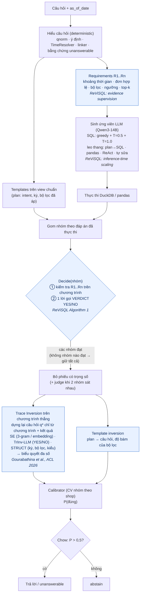

# DataMate Agent — Zalo AI Challenge 2026

AI agent trả lời câu hỏi tiếng Việt đời thường trên dữ liệu bảng của cửa hàng nhỏ (CSV / Excel / SQLite), **biết khi nào
không nên trả lời**. Hệ thống tối ưu cho *Penalized Accuracy*: đúng +1, abstain 0, sai −1.

```
{"id": "q_06de33fa21cc", "business_id": "biz_118", "question": "sp bán dc nhiều nhất tuần rồi là gì", "as_of_date": "2026-03-04"}
→ {"id": "q_06de33fa21cc", "type": "string", "answer": "Xi măng Hà Tiên PCB40 bao 50kg"}
```

Thiết kế chi tiết, kèm trích dẫn cho từng phương pháp: [`docs/DESIGN.md`](docs/DESIGN.md). Tài liệu tham khảo: [`docs/REFERENCES.md`](docs/REFERENCES.md).
Kết quả: [`docs/RESULTS.md`](docs/RESULTS.md).

## Ý tưởng chính
1. **Quy tắc Chow**: với điểm +1/0/−1, chỉ trả lời (kể cả `unanswerable`) khi P(đúng) > 0.5. Calibrator được fit bằng
   cross-validation **nhóm theo shop**, để ước lượng phản ánh shop chưa từng thấy.
2. **View chuẩn theo rulebook**: từ hơn 40 cách tổ chức file, hệ thống dựng `v_sales`, `v_orders`, `v_products`,
   `v_purchases`. Các luật đơn hợp lệ, trả một phần thì bỏ cả đơn, đơn vị cơ bản, phí phục vụ/voucher, khách lẻ được áp
   **một lần** tại đây. View có tự kiểm tra và tỉ lệ khớp được dùng làm đặc trưng tin cậy.
3. **Rulebook theo split**: văn bản rulebook nằm ở đầu prompt; quy ước được đọc từ văn bản; template chỉ chạy khi gặp đúng
   điều luật nó cài đặt (dấu vân tay điều luật). Khi rulebook đổi, template tự tắt và LLM xử lý.
4. **Deterministic ở những chỗ có thể**: thời gian tương đối, khung Tết theo lịch âm, ca sáng/chiều, tie-break theo mã,
   làm tròn, định dạng đáp án.
5. **Nhiều họ ứng viên**: template, SQL, plan→SQL, pandas, ReAct, cùng bước tự sửa bằng phản hồi thực thi. Đáp án chọn bằng
   bỏ phiếu theo kết quả thực thi.
6. **Đúng luật thi**: Qwen3-14B (≤ 15B tham số), offline, seed theo nội dung câu hỏi, ngân sách 6 giờ, ghi
   `submission.jsonl` theo từng dòng, log từng câu trong `/result/logs/`.
7. **ReViSQL** [R40]: mỗi câu có danh sách requirement R1..Rn (thời gian, đơn hợp lệ, bộ lọc, ngưỡng…) đưa vào prompt;
   ứng viên sinh bằng greedy + nhiều nhiệt độ; các nhóm đáp án được *reconcile*, chỉ nhóm có chương trình phủ đủ
   requirement mới được bỏ phiếu.
8. **Trace Inversion** [R39]: dựng lại câu hỏi chỉ từ chương trình thắng rồi so với câu gốc (SE, TrInv-LLM, STRUCT,
   biểu quyết đa số). Khi model "trả lời một câu hỏi khác", tín hiệu này hạ P(đúng) và hệ thống abstain.



## Kết quả hiện tại (chế độ không LLM, CPU)
| Split | Đúng | Sai | Bỏ qua | PA |
|---|---:|---:|---:|---:|
| Train (3.000 câu, chấm bằng luật chính thức, **trong mẫu**) | 2.667 | 3 | 330 | 0,888 |
| Public (1.000 câu, chưa có đáp án) | 611 đáp án + 24 `unanswerable` | – | 365 | – |

Bài nộp vòng 1: [`submissions/public_test_round1.jsonl`](submissions/public_test_round1.jsonl). Chi tiết và cách đọc con số:
[`docs/RESULTS.md`](docs/RESULTS.md).

## Cài đặt
```bash
python -m pip install -r requirements.txt      # Python ≥ 3.10
make test                                       # unit + end-to-end trên split synthetic, không cần GPU
```

## Vòng 1 (public test): tạo `submission.jsonl`
Bố cục split theo đúng quy định: `<split>/{questions.jsonl, rulebook.md, calendar.csv, data/<business_id>/…}`.

**A. Có GPU (đầy đủ, khuyến nghị)**
```bash
# 1) phục vụ Qwen3-14B bằng vLLM (2 GPU, tensor parallel)
vllm serve Qwen/Qwen3-14B --tensor-parallel-size 2 --enable-prefix-caching --max-model-len 32768 --seed 0
# 2) fit calibrator trên train, dùng chính LLM đó (bắt buộc: calibrator mặc định chỉ là prior)
python scripts/run.py --data path/to/train --out runs/train_sub.jsonl --dump runs/train_dump.jsonl
python scripts/fit_calibrator.py runs/train_dump.jsonl path/to/train/answers.jsonl --out artifacts/calibrator.pkl
# 3) trả lời public test
python scripts/run.py --data path/to/public_test --out submission.jsonl --logs runs/public_logs
```

**B. Không có GPU (template + luật, chạy nhanh, dùng calibrator offline đã fit sẵn)**
```bash
python scripts/run.py --data path/to/public_test --out submission.jsonl --logs runs/public_logs \
    --set llm.backend=none --set decision.calibrator_path=artifacts/calibrator_offline.pkl
```

**Đánh giá trên train** (có đáp án):
```bash
python scripts/eval_templates.py --split path/to/train --out runs/train_offline_dump.jsonl   # theo ý định, theo shop
python scripts/evaluate.py submission_train.jsonl path/to/train/answers.jsonl              # PA đúng luật chính thức
```

## Vòng nộp lời giải: Docker (chuẩn bị sẵn)
`predict.sh` đọc `/data`, ghi `/result/submission.jsonl` và `/result/logs/<id>.json` (id, đáp án, thời gian, ý định, khoảng
thời gian, mọi chương trình ứng viên và output). Script tự khởi động vLLM (TP=2), chạy offline (`HF_HUB_OFFLINE=1`), và
chuyển sang chế độ template sau `run.fast_after_s` để không vượt 6 giờ. `Dockerfile` là khung mẫu; base image thay theo
hướng dẫn Docker của BTC (Blackwell cần CUDA ≥ 12.8).

## Mô hình đã dùng (khai báo theo luật số 2)
| Mô hình | Tham số | Giấy phép | Phát hành | Vai trò |
|---|---|---|---|---|
| Qwen/Qwen3-14B | 14,8B | Apache-2.0 | 04/2025 | sinh SQL/pandas, ReAct, judge, verdict reconciliation, dựng lại câu hỏi (Trace Inversion) |
| *(tuỳ chọn, mặc định tắt)* intfloat/multilingual-e5-small | 0,118B | MIT | 2023 | module SE của Trace Inversion khi đặt `inversion.se_model` |

Mặc định chỉ dùng Qwen3-14B: module SE dùng độ tương đồng 3-gram ký tự, không cần model. Nếu bật encoder tuỳ chọn, tổng là
14,918B ≤ 15B; `scripts/run.py` cộng cả encoder vào khi kiểm tra ngân sách. Không dùng Granite Guardian (module GROUND
của Trace Inversion) vì 8B vượt trần.

## Cấu trúc repo
```
datamate/
  textnorm.py      chuẩn hoá: luật so chuỗi chính thức, bỏ dấu, sửa lỗi gõ Telex, tiền/số lượng kiểu Việt
  loader.py        CSV/XLSX(calamine)/SQLite → DuckDB; header, sheet theo tháng, ngày/tiền/số lượng hỗn hợp, cache
  readme.py        từ điển cột README, quy ước, ngày cuối dữ liệu, dòng quy đổi đơn vị
  roles.py         gán vai trò cột (README → tên cột → kiểu) và phân loại bảng
  salesview.py     v_sales / v_orders / v_products / v_purchases theo rulebook + tự kiểm tra, bảng tên → mã
  attributes.py    thuộc tính danh mục làm bộ lọc (hoạt chất, thương hiệu, cờ "kê đơn"…)
  requirements.py  requirement R1..Rn của câu hỏi + kiểm tra chương trình (ReViSQL evidence supervision, reconciliation)
  inversion.py     Trace Inversion: dựng lại câu hỏi từ chương trình, SE / TrInv-LLM / STRUCT, template inversion
  reward.py        reward kiểm chứng được cho RLVR (ReViSQL), chỉ dùng khi xuất dữ liệu huấn luyện
  rulebook.py      rulebook theo split: văn bản, quy ước, dấu vân tay điều luật
  lunar.py         lịch âm (file BTC, fallback thuật toán)
  timeresolver.py  cách nói thời gian → [start, end)
  question.py      ý định, kiểu đáp án, k, ngưỡng, bộ lọc
  linker.py        liên kết giá trị câu hỏi ↔ dữ liệu, phát hiện mặt hàng không tồn tại
  answerability.py bằng chứng "không trả lời được"
  templates.py     chương trình deterministic cho các ý định phổ biến
  prompts.py       contract + generator SQL/plan/pandas/ReAct/fix/judge
  executor.py      DuckDB chỉ đọc có timeout; sandbox Python chạy tiến trình riêng
  formatter.py     kết quả → (type, answer); khoá chuẩn hoá để bỏ phiếu; tie-break
  agent.py         điều phối end-to-end
  calibrate.py     calibrator (prior / logistic + isotonic), ngưỡng tối ưu PA
  scorer.py        luật chấm chính thức (có alias)
  synthetic.py     sinh split synthetic theo bố cục chính thức (dùng cho test)
scripts/  run.py · evaluate.py · eval_templates.py · fit_calibrator.py · export_rlvr_data.py · make_synthetic.py ·
          inspect_business.py · serve_vllm.sh
predict.sh · Dockerfile · configs/{default.yaml, rulebook_overrides.yaml} · tests/ · docs/
```

## Giới hạn
- Môi trường phát triển chỉ có CPU nên chưa đo được PA khi có LLM. Đường LLM đã được kiểm thử bằng LLM giả lập và một model
  1,5B trên CPU. Cần chạy bước A.2 (fit calibrator với LLM) trên GPU trước khi nộp bản có LLM.
- Ở chế độ không LLM, các ý định ngoài lõi bán hàng và nhập hàng (công nợ, tồn kho, lô/hạn dùng, giao hàng, ngành đặc thù)
  đều abstain.
- Số trên train là số trong mẫu: lỗi được tìm bằng cách đọc câu sai trên train rồi sửa ở tầng tổng quát. Shop mới sẽ thấp hơn.
- Các lỗi đọc file (dòng tổng, header, quy đổi đơn vị, sổ tay không có mã đơn) được sửa sau khi chạy hệ thống trên file dữ
  liệu public. Không có luật ý định nào được viết dựa trên câu hỏi public, và public không có đáp án.
